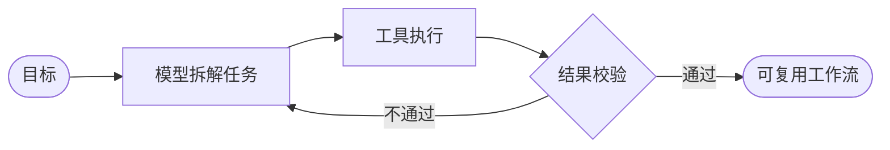

 

**AI-native 的工程方式 · 把模型接进真实系统，而不是停在 demo。**

 

 

## 核心能力

<table>
<tr><td width="24%"><b>AI 工作流</b></td><td>用模型当执行者、用代码当约束，把一次性操作变成可重复运行的工作流。不是画给人看的流程图，是能自己跑完的流程。</td></tr>
<tr><td><b>AI 应用工程</b></td><td>LLM 应用、Agent 编排、工具调用、RAG 检索。关心上线之后能不能维护，不只是 demo 能不能跑。</td></tr>
<tr><td><b>后端底子</b></td><td>Java / Spring 生态出身。高并发、幂等、事务边界、连接池——判断一个 AI 方案能不能扛住真实流量，靠的是这些。</td></tr>
<tr><td><b>评测与质量</b></td><td>先有评测集再谈效果。检索质量、上下文预算、失败重试，都要能被度量。</td></tr>
</table>

## 工作流

我的工作方式不是「人按流程操作」，而是「模型执行、代码约束」。

把目标拆成可验证的步骤，给每一步配上工具和边界，让模型在边界内自己跑；
跑完自动校验，不达标就回到上一步，达标就沉淀成下一次能直接复用的流程。
判断力留在设计阶段，执行交给模型。

<table>
<tr><td width="24%"><b>模型是执行者</b></td><td>不是聊天窗口。每个环节有明确的输入、输出和失败处理。</td></tr>
<tr><td><b>约束写在代码里</b></td><td>工具白名单、参数校验、步数上限、幂等保证。模型可以有想象力，系统不能。</td></tr>
<tr><td><b>可重复才算解决</b></td><td>一次性跑通是运气，跑一百次仍然对才是能力。</td></tr>
</table>

## 现在

<table>
<tr>
<td width="33%" valign="top"><b>在做</b>  Agent 工作流编排，把重复的研发操作固化成可执行流程。</td>
<td width="33%" valign="top"><b>在研究</b>  工具调用可靠性、上下文工程、检索评测方法。</td>
<td width="34%" valign="top"><b>在补</b>  Java 后端深度：JVM 调优、分布式一致性。</td>
</tr>
</table>

## 工程观

> **模型负责概率，系统必须确定。**
> 边界画在代码里，不画在 prompt 里。

> **没有评测集的 AI 功能，等于没有功能。**
> 「感觉挺好用」不是验收标准。

> **先跑最简单的版本。**
> 简单方案撑一周不塌，再考虑要不要上 Agent。

## 技术栈

<table>
<tr><td width="22%"><b>AI</b></td><td>LLM 应用 · Agent · 工作流编排 · RAG · Context Engineering · 评测体系</td></tr>
<tr><td><b>语言与框架</b></td><td>Python · Java · Spring Boot · Spring Cloud</td></tr>
<tr><td><b>存储与中间件</b></td><td>MySQL · Redis · Elasticsearch · Kafka</td></tr>
<tr><td><b>工程与运维</b></td><td>Linux · Docker · Kubernetes · GitHub Actions</td></tr>
</table>

 

<b>English</b>

 

### About

I build AI-native systems — LLM applications, agent workflows, and RAG pipelines that
survive production, not just the demo.

Backend roots: the Spring ecosystem and the JVM. That is the lens I put on any AI design —
not *does the demo work*, but *who maintains this in three months*.

### Workflows, with the model as the executor

I do not draw flowcharts for people to click through. I decompose a goal into verifiable
steps, give each step its tools and its limits, and let the model run inside those limits.
Results are checked automatically: pass, and the flow becomes reusable; fail, and it goes
back a step.

- **The model executes** — not a chat window. Every step has defined inputs, outputs and a
  failure path.
- **The constraints live in code** — tool allow-lists, argument validation, step ceilings,
  idempotency. The model can improvise; the system cannot.
- **Repeatable or it does not count** — working once is luck, working a hundred times is
  engineering.

### How I work

- **Keep the model probabilistic and the system deterministic.** Draw the boundary in code,
  not in the prompt.
- **No eval set, no feature.** "It feels good" is not an acceptance criterion.
- **Ship the boring version first.** If the simple design holds for a week, then consider
  the agent.

### Stack

| Layer | Contents |
| :-- | :-- |
| AI | LLM apps · Agents · Workflow orchestration · RAG · Context engineering · Evals |
| Language & frameworks | Python · Java · Spring Boot · Spring Cloud |
| Storage & messaging | MySQL · Redis · Elasticsearch · Kafka |
| Engineering | Linux · Docker · Kubernetes · GitHub Actions |

 

Updated as I go.

